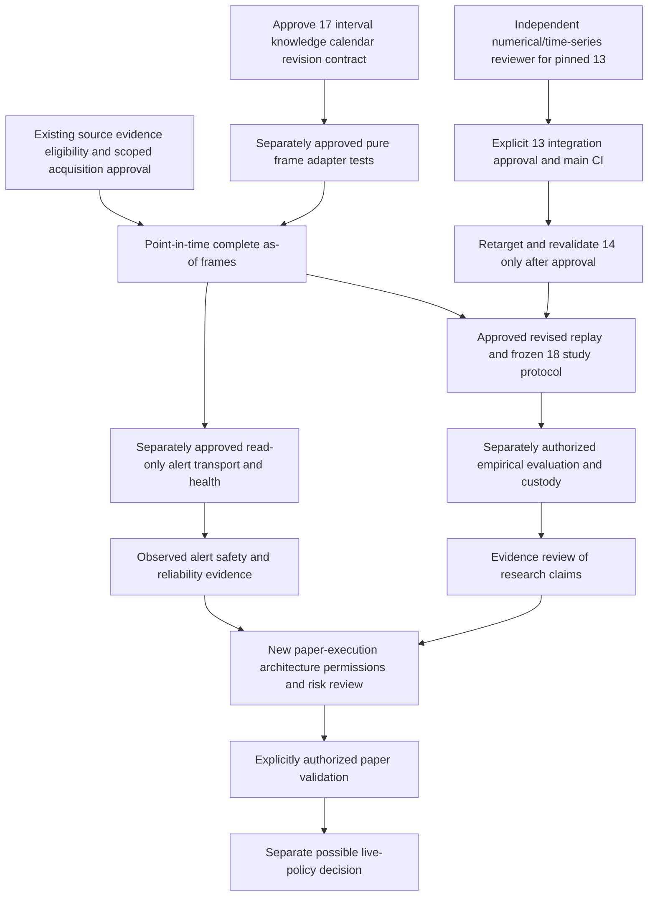

# H-005 — dependency and blocker map
Scope/observations: [README](README.md). Status proposed readiness analysis; all owners below are roles, not invented assignees. UNKNOWN means no establishing evidence in the inspected scope.

## Capability boundary
Current reviewed product capability is a pure SPY/QQQ ETF directional research hypothesis plus an offline retrospective replay proposal. A live read-only alert would require fresh, completed, as-of available observations and trustworthy metadata. A paper order is execution against a broker simulator and is NOT read-only. Live execution, options selection, permissions and predictive value remain UNKNOWN and unauthorized. No automatic transition from alerts to paper or paper to live.

## Dependency graph

Graph expresses proposed prerequisite gates, not authorization. Source evidence may be absent indefinitely; unknown availability blocks historical primary evaluation even if all code tests pass. Read-only alert engineering can be evaluated for reliability without predictive edge claims, but cannot bypass source-completion/availability or API-access gates.

| Node / role owner | Current status | Exact required evidence / acceptance | Blocking relationship |
|---|---|---|---|
| #13 engine; independent reviewer + maintainer | Review packet ready; no independent review or merge permission | Exact SHA review, qualifications/access/independence, material findings resolved, new relevant CI and explicit merge authorization | Blocks approved integration; not every separate offline test proposal |
| #14 replay; maintainer + research owner | Combined CI exists, still stacked | After authorized #13 merge: main CI, new target diff/checkouts, cumulative Windows/Linux CI and separate approval | Existing publication-event/idealized labels are not #18 study implementation |
| #17 adapter; contract reviewers UNKNOWN | Design-only, G-H003-2 closed | Scoped mapping authority, UTC clock/precision, per-revision knowledge, completion watermark, finality distinction, pinned calendar and conflicts policy | Blocks canonical real-history frames and provider alert feed |
| #18 study; research maintainer/custodian UNKNOWN | DRAFT, no freeze/execution | Choose estimands/date weights, missingness scenarios, shared grid/labels, daily/peer rules, exact future dates, custody/access evidence, cost-proxy limits | Blocks confirmatory evaluation; cannot authenticate itself with manifest text |
| Source evidence; evidence owner UNKNOWN | Raw capture/revision availability UNKNOWN | Existing approved location/hash, endpoint/SDK/OpenD/flags, entitlements, full receipt/clock bounds, exact revision identity, pagination/calendars/daily lineage | Cannot substitute today's final history or bar-end assumed availability |
| Pure offline schema/serialization reliability; engineering owner | Separately approvable proposal, not authorized implementation | Contract-preserving synthetic failure reproduction, finite output/no mutation, existing APIs/math unchanged, isolated branch CI | Does not need real market history/custody; still needs explicit G-H003-3 bounded exception |
| Real-time read-only adapter/health; data/platform owner UNKNOWN | Not implemented or authorized | Approved source access, no trade-context dependency, bounded reconnect/backpressure, clock/freshness health, unavailable states, explicit event audit | Separate from existing dashboard worker ingestion and legacy stores |
| Research claims; independent reviewer/research owner | No demonstrated edge | Approved dataset/freeze/labels/inspection and uncertainty/missingness evidence, all arms including negative results | CI/synthetic labels cannot unlock profitability claims |
| Paper execution; owner/risk/operator UNKNOWN | NOT READY | Entire design checklist, scoped paper permission, broker capabilities, state machine and kill-switch evidence | Not part of current read-only scanner; no simulation authorized |
| Live execution | OUT OF SCOPE | New explicit product/risk/security/legal/broker decisions and independent safety review | No route authorized by H-005 |

## Critical paths and parallel work
Integration critical path: independent reviewer -> exact #13 decision -> resulting main CI -> reviewed #14 retarget/cumulative CI -> separate integration decision. No merges happen in this review.
Data/research critical path: source eligibility + contract choices -> as-of frame implementation approval/tests -> approved capture/custody and revised replay -> freeze actual dates/access -> authorized evaluation -> independent result review. Missing historical knowledge cannot be engineered away.
Read-only alert critical path: verified current source semantics/completion/latency and permissions -> approved pure adapter -> isolated approved transport/health -> fault-tested operator-visible alerts. Doesn't require options/ordering features; doesn't claim predictive usefulness.
Possible independent low-risk work: numerical-output or malformed-input test-only reproduction, non-live schema/serialization checks, immutable run-identity design. Each needs a bounded approval, does not merge #13 or freeze #17. See roadmap alternatives. Do not start source-sensitive adapter/calendar/revision changes under a generic “reliability” label.

## Genuine blockers versus ready proposals
Blocked NOW: all integration/implementation/source access/study/order actions because G-H003-1/2/3/4 remain closed; independent reviewer unassigned and source evidence unknown. Ready for DECISION only: reviewer packet, five-point contract clarification, H-004 algebra/decision matrix, and a small offline test-only next-step proposal. “Ready for separately authorized work” is not work already authorized.
Next owner decision: designate reviewer/evidence/custody roles and choose one explicit next scope. Retain raw/provider evidence, exact versions, source limitations and no-trade/blocked distinction. No silent shifts, missing-bar fabrication, store migration, or performance/0DTE execution inference.
